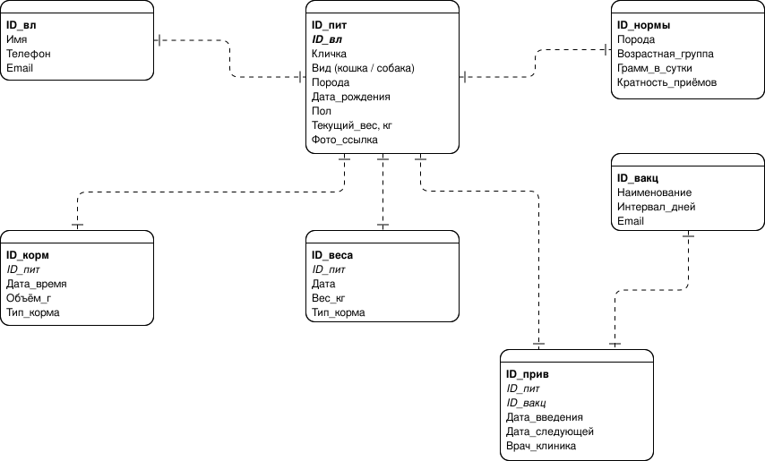
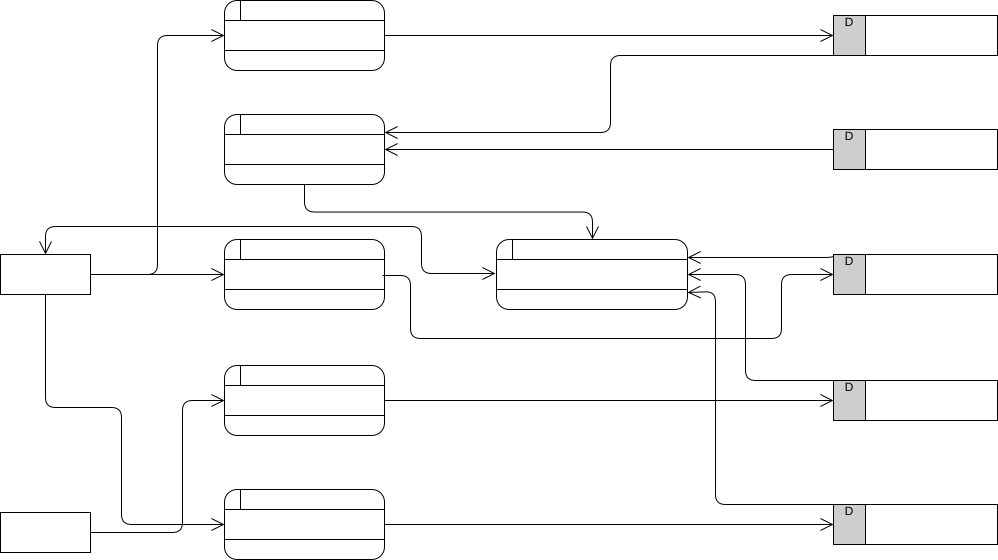

# Диаграммы проекта PetCare

## 1. Диаграмма вариантов использования (UML Use Case)
Графическое представление пользовательских сценариев взаимодействия с системой.

### Описание связей:
| Связь | Тип | Обоснование |
|-------|-----|-------------|
| UC-5 → UC-3 | `include` | Для формирования напоминания о кормлении система обязана прочитать журнал кормлений. |
| UC-5 → UC-4 | `include` | Напоминание о прививке требует чтения графика вакцинации. |
| UC-7 → UC-6 | `extend` | Просмотр графика веса активируется только при наличии истории замеров (>1 записи). |

---

## 2. Функциональная модель (IDEF0)
Описывает процессы учёта здоровья питомца с точки зрения входов, выходов, управления и механизмов.

---

## 3. Информационная модель (ERD)
Логическая структура данных приложения. Определяет сущности (Питомец, Владелец, Кормление и Вакцинация) и связи между ними.

На этапе MVP данная схема реализуется через JSON-структуры в LocalStorage браузера пользователя.

---

## 4. Модель информационных потоков (DFD)
Показывает движение данных между внешними сущностями (Владелец и Ветклиника), процессами обработки и хранилищами данных.

